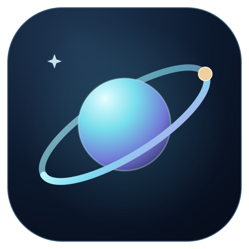
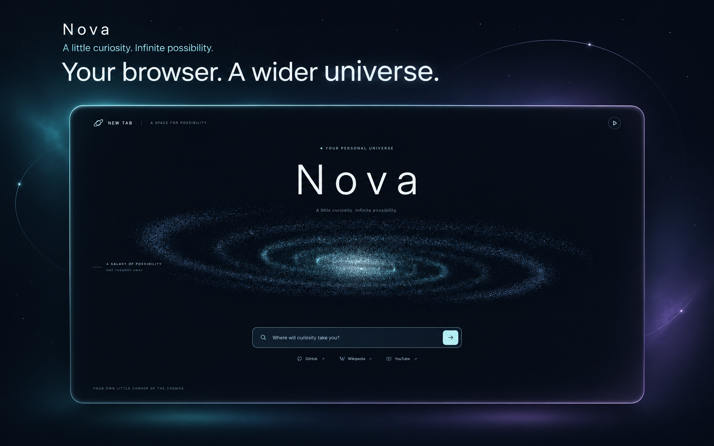
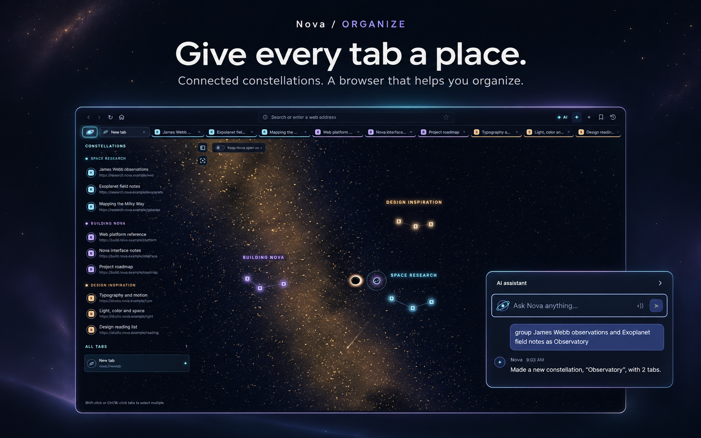
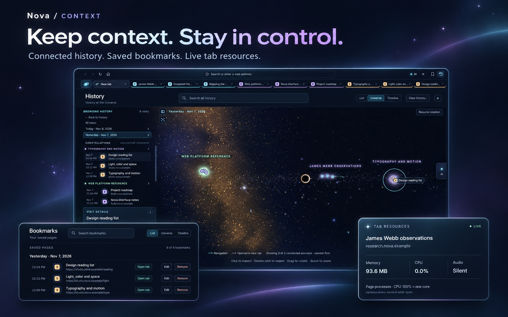

  

<h1 align="center">Nova</h1>

<strong>A little curiosity. Infinite possibility.</strong>

A desktop browser that turns your tabs, history, and bookmarks into a universe you can explore.

  <a href="#install-and-launch-nova">Get started</a> ·
  <a href="#built-for-curiosity">Explore Nova</a> ·
  <a href="#build-a-distributable-app">Build an AppImage</a> ·
  <a href="docs/screenshots/README.md">Original captures</a>

## Built for curiosity

Keep familiar browser controls close and give your browsing a little more perspective. Nova combines Chromium-backed pages with a spatial workspace and an assistant that can help organize your tabs.

| Organize your space | Keep the thread | See what is happening |
| --- | --- | --- |
| Group related tabs into constellations and move through a visual overview. | Explore connected history and save the pages you want to return to. | Inspect live tab memory, CPU, and audio status with a hover. |

### A place for every line of thought

Name a constellation for your research, your next build, or the ideas you are collecting. Use the sidebar, select a star, or ask Nova to group named tabs. Connect an AI endpoint for broader organization requests.

### Context you can come back to

History connects the steps in a browsing journey. Bookmarks keep useful pages across restarts. Resource cards show what a tab is using while the page keeps running. Each view shares Nova's space-inspired visual language.

[View the unedited screenshots](docs/screenshots/README.md)

Nova is an Electron and Three.js desktop browser prototype created for the UB Hacking 2026 deep-space theme. Its assistant supports local Ollama and compatible chat endpoints; the setup guides below cover local and hosted options.

## What you need

- A computer running macOS, Windows, or Linux.
- Node.js with npm. Electron recommends the current Node.js LTS release for development. Install it from https://nodejs.org/en/download/.
- An internet connection for installing Electron and for visiting websites.
- Optional: an Ollama server or a compatible chat-completions endpoint for model-powered answers and tab grouping. Browsing, history, bookmarks and built-in assistant commands work without one.

Check that Node.js and npm are installed by opening a terminal and running:

    node -v
    npm -v

Both commands should print version numbers. On Windows, use PowerShell or Command Prompt to run the desktop app rather than WSL.

## Install and launch Nova

1. Open Terminal, PowerShell, or Command Prompt.
2. Change to the project folder. Replace the example path with the folder where you saved this project:

       cd "/path/to/Nova"

   On Windows, a path might look like:

       cd "C:\path\to\Nova"

3. Install the project dependencies:

       npm install

   This installs Electron and electron-builder. Electron also downloads its platform binary, so this step may take a few minutes and needs access to npm and Electron's release downloads.

4. Start the browser:

       npm start

Nova opens with a local space start page filling the window. Its point-cloud galaxy reveals outward from the core, turns slowly around a dark dust lane, and responds gently to mouse movement. The galaxy uses the app’s cyan, blue and lavender palette. Rendering and geometry are local, with a smaller Canvas fallback when WebGL is unavailable. Use its search box to search the web or enter a URL; GitHub, Wikipedia and YouTube shortcuts are included. The page works offline, respects reduced-motion preferences, offers a pause button, and suspends animation while hidden. Press Ctrl+Space to bring up the Nova assistant as a Spotlight-style popup over the page.

Nova uses a `Nova` profile folder under the operating system's application-data directory. When that folder does not yet exist, the first launch copies an earlier browser profile and carries forward bookmarks, history, settings and browser storage, leaving the original profile untouched. Nova writes `nova-bookmarks.json`, `nova-history.json` and `nova-settings.json`; existing Nova data is never overwritten by the migration. Interface preferences, including animation and sidebar settings, also migrate. Use `NOVA_USER_DATA` for a custom profile, `NOVA_START_URL` for a startup destination, and `NOVA_TEST_HIDDEN=1` for isolated hidden-window tests.

Run `npm run test:branding` to check the Nova identity, profile migration, preferences, desktop registration and new-tab branding.

## Use the browser

- **Open a page:** Enter a website address or search phrase in the address bar and press Enter.
- **Search suggestions:** The address bar and new-tab search combine matching history, bookmarks, open tabs and Google autocomplete. Use ↑ / ↓ to choose a result and Enter to open it; open-tab results switch to the existing tab. Escape dismisses suggestions. Local results work offline. After a short typing pause, ordinary search phrases are sent to Google for autocomplete without browser cookies; full addresses, email addresses and URL parameters stay local. History and bookmarks are matched on your device.
- **Read or edit an address:** While browsing, HTTPS addresses omit `https://`, a leading `www.`, and an empty trailing slash. Other subdomains, ports, paths, query parameters and fragments remain visible. HTTP keeps its scheme and a **Not secure** indicator. Click the address bar or press Ctrl+L / Command+L to reveal and select the full address for editing or copying; Escape restores the current page address. Trimming changes only the display.
- **Check connection security:** A lock appears only when Chromium reports a secure main-page HTTPS response with a currently valid certificate. Hover over it for the issuing authority and expiry. Navigation clears the previous lock; certificate failures and loaded insecure content never receive a lock. If verification is unavailable, Nova shows a neutral information icon. Electron continues to reject invalid certificates by default.
- **Switch tabs:** Use the tab strip next to the address bar.
- **Inspect tab resources:** Hover over a tab, or focus it with the keyboard, to see its live memory use, CPU use, and audio state (**Playing**, **Muted**, or **Silent**). The card updates once per second while open; Escape dismisses it, and sampling stops when it closes. Memory is the resident memory of the page's renderer processes, including iframe renderers, displayed in MB. CPU uses 100% for one logical core and can exceed 100% for multithreaded pages. When a process serves multiple tabs, the card labels its shared totals. Shared browser, GPU and audio-service processes are excluded. The page stays running while you inspect it.
- **See all tabs as a cosmos:** Select **✦** in the toolbar or press Ctrl+Shift+O (Command+Shift+O on macOS). Every open tab is a star in a 3D galaxy; tabs from the same site share a colour and the current tab has a ring around it. Drag to rotate, scroll to zoom, and select a star or its label to switch to that tab. Press Esc or select **✦** again to return to the page. Zoomed out, the cosmos shows constellation names; zoom in or select a constellation's name to see its tab titles. Double-click empty space to see everything again.
- **Group tabs into constellations:** Each group of tabs becomes its own constellation, with its stars joined by lines. To make one:
  - Right-click a tab (in the tab strip or the cosmos) and choose **New constellation with this tab** or **Add to constellation**.
  - In the cosmos, Shift-click several stars and select **Make a constellation**, then type its name.
  - Ask the assistant, for example “group github, mdn and node as Dev” or “ungroup Dev”.
  - Describe the grouping you want in your own words, for example “group my tabs by project”, “put everything about the trip to Japan together”, or “split my tabs into work and personal”. With an AI endpoint connected, the assistant sends your instruction and your open tab titles and URLs to the model, which plans the constellations; Nova then creates or updates them. Without an endpoint, “group my tabs by site” still works.

  Drag a star onto another star or constellation to group it, or drag a constellation name onto another group to merge them. Dropping a star onto the black hole closes its tab. The cosmos sidebar supports selecting multiple tabs to group or close together and can be collapsed.

  Grouped tabs have a coloured line under them in the tab strip. Links opened from a grouped tab join its group. To rename a constellation, double-click its name in the cosmos or use the right-click menu. Groups last until Nova closes.
- **Open a tab:** Select **＋** or press Ctrl+T (Command+T on macOS). Each blank tab opens the local space start page with an empty address bar; explicit website links still open their destination.
- **Close a tab:** Select its × button or press Ctrl+W (Command+W on macOS). Closing the last tab opens a fresh space start page.
- **Navigate:** Use the back, forward, reload and Home buttons. Home returns to the local space start page.
- **Use keyboard shortcuts:** Ctrl+L / Command+L focuses the address bar. Ctrl+Space opens or closes the Nova assistant popup (Esc or a click outside also closes it). Ctrl+Shift+O / Command+Shift+O shows or hides the tab cosmos. The application menu lists the main shortcuts.

Nova uses a persistent Chromium session, so website cookies, site storage, and cache are retained between launches. Open **Settings → Cookies and cache** to clear cookies and site data, cached images and files, or both. Clearing cookies can sign you out of websites; saved browsing history is managed separately. Website links that open a new window are opened as a new Nova tab. Sites that request camera, microphone, location, or notification access show a Nova permission prompt.

## Bookmarks

Select the **Bookmarks** ribbon beside History in the upper-right toolbar, or press **Ctrl+Shift+B / Command+Shift+B**. Like History, Bookmarks has **Universe**, **List**, and **Timeline** views. Universe groups saved pages from the same website into constellations; Timeline follows their saved dates, and List shows the newest saved pages first. Search filters matching titles and addresses, turning list results into stars while you type.

Click the star beside the address bar or press **Ctrl+D / Command+D** to save the current website. A filled star marks a saved page; clicking it again edits its name or address. You can also edit or remove bookmarks from List or the star-details panel. Opening a bookmark returns to its existing tab when available, otherwise opening a new tab. Internal new-tab screens cannot be bookmarked.

Bookmarks are saved locally in `nova-bookmarks.json` in the application profile and survive restarts independently of history, cookies and cache. **Clear bookmarks…** asks for confirmation. Bookmarks also appear in local address-bar and new-tab suggestions. Run `npm run test:bookmarks` for persistence, editing, duplicate handling, website constellations, keyboard/menu actions, native tab opening and the narrow layout; previews are saved to `artifacts/bookmarks-list.png`, `artifacts/bookmarks-universe.png`, and `artifacts/bookmarks-narrow.png`.

## Talk to Nova and let it look things up

Nova can open pages on its own and answer from what they show. Ask something that needs live information, for example “check the prices for a ticket to SFO next week”. Nova opens the relevant page (Google Flights, in this case) in a **side tab** between your current page and the assistant, reads it once it has loaded, and replies with what it found. Your current page stays where it is.

- **Side tab:** The side tab is marked with a dashed outline in the tab strip. Use the arrow button in its header to make it your main tab, or × to close it. Selecting it in the tab strip also makes it the main tab. A new lookup replaces the previous side tab.
- **Talk to Nova hands-free:** Select the mic button in the assistant to turn voice activation on; it glows cyan while it listens. Then say “Hey Nova” followed by your request, for example “Hey Nova, check the prices for a ticket to SFO next week”. You can also say just “Hey Nova”, wait for “Yes? I'm listening.”, and say the request within 8 seconds. Plain browser commands such as “Hey Nova, open github.com” work too. Replies to spoken requests are read aloud, and Nova stops listening while it works and speaks so it doesn't hear itself. The speaker button reads replies to typed requests aloud as well.
- **Keep voice costs down:** Select the mic button again to turn voice activation off. The microphone closes and nothing is sent. Voice activation starts off each time Nova opens.
- **Detect “Hey Nova” on your computer (recommended):** Get a free AccessKey from the [Picovoice Console](https://console.picovoice.ai/) and paste it under **AI settings → Voice → Picovoice AccessKey**, or launch Nova with `PICOVOICE_ACCESS_KEY` set. The first time you turn voice activation on, Nova asks Picovoice to build the “hey nova” wake word, which takes a few seconds, and keeps it in your profile. From then on, Porcupine listens for the phrase on your computer: no audio leaves it until you say “Hey Nova”. You hear a short tone, then only your request is sent to ElevenLabs. The AccessKey is stored encrypted and is handed to the wake word engine in the Nova window, which uses it only to activate itself with Picovoice.
- **Without a Picovoice AccessKey:** Nova detects speech on your computer and sends each stretch of talking, up to 12 seconds, to ElevenLabs, then ignores anything that doesn't start with “Hey Nova”. Silence is never sent, but conversation, music or video near the microphone is transcribed and costs money, so turn voice activation off when you aren't using it.
- **Set up voice:** Open AI settings (⚙ in the assistant) and paste an ElevenLabs API key under **Voice**. The key is encrypted with your operating system's secret storage. You can also launch Nova with `ELEVENLABS_API_KEY` set. Optionally enter an ElevenLabs voice ID to change the voice.
- **What is sent where:** While voice activation is on, your request (or, without a Picovoice AccessKey, each detected utterance) goes to ElevenLabs speech-to-text (Scribe), and spoken replies go to ElevenLabs text-to-speech. Your request, open tab titles and URLs, and the text of pages Nova opens go to your configured AI endpoint. Nova treats page text as untrusted data. It reads pages but never clicks, types or submits anything on them.
- **Which models work:** Looking things up needs an AI endpoint. The model must reply with a small JSON action, so pick one that follows instructions well. Models that ignore the format still answer, but without opening pages.

## History

Select the **History** clock icon in the upper-right toolbar, or press **Ctrl+H / Command+H**. History opens in **Universe** mode, showing the five newest connected journeys around the black hole while the sidebar retains the full history. **List** shows page visits grouped by date; **Timeline** shows up to twenty visits in chronological order. Each history entry shows its title, address, favicon and visit time.

Start typing in **Search history** to filter the sidebar and visualization. Results update on each edit. Clearing the query or pressing Escape in the search box restores the selected view. The Universe scene has no date markers; date filters remain in the sidebar.

The Universe scene shares Nova's backdrop, black hole, favicon stars and collapsible history sidebar. Connected visits form branching constellations positioned around the black hole, with no date markers in the scene. Only actual navigation links and new-tab relationships connect visits; hidden intermediate visits never produce invented shortcuts. Choose a date in the sidebar to filter the scene. Select a star or sidebar entry for visit details, double-click a star to reopen it, and use **F / Fit journeys** to fit the results. Drag to rotate, right-drag to pan, and scroll to zoom. Timeline mode keeps the camera fixed and syncs its twenty visible stars with the chronological sidebar. Reduced-motion preferences are respected, and the WebGL scene stops animating when History is closed. The List view remains available without 3D graphics.

History records top-level HTTP(S) visits, including favicons, navigation branches and closed-tab trails, and retains up to 3,000 visits locally in `nova-history.json` under Electron's user-data directory. The Universe scene visualizes five connected journeys; Timeline shows twenty visits at a time. Search scans all retained visits, including entries not yet shown in the sidebar. Date filters can reach older matches. Back/forward returns to existing visit nodes; new navigation preserves earlier branches. Reopening loads the page's current contents. Visits from before recording was introduced cannot be reconstructed.

**Clear history…** asks for confirmation and deletes saved visit metadata without closing tabs or clearing website cookies. Titles and addresses are rendered as text. The assistant can search matching history when you explicitly ask it to find or remove entries; those matching records may be sent to the configured model.

Run `npm run test:newtab` for the local start page, particle reveal, WebGL recovery, offline fallback and motion preferences, and `npm run test:address` (with OpenSSL installed) for address and connection states. The `npm run test:history` suite covers history models, persistence, search, native navigation and layout geometry; some desktop assertions still target the earlier List-first interface. History previews are saved to `artifacts/history-list.png` and `artifacts/history-search-constellations.png`.

Run `npm run test:suggestions` for autocomplete filtering, local ranking, stale-response handling, keyboard selection, tab switching, offline history and suggestions on the new-tab page. Preview images are saved to `artifacts/address-suggestions.png` and `artifacts/newtab-suggestions.png`.

Run `npm run test:resources` for real CPU load, memory allocation, audible/muted/silent audio, renderer sharing, keyboard access, hover cleanup and closed tabs. The card preview is saved to `artifacts/tab-resources.png`.

## Assistant and voice controls

Press **Ctrl+Space** to open the assistant. Type a request and press Enter to send it; Shift+Enter adds a new line. The following commands work without connecting a model:

| Try saying or typing | What Nova does |
| --- | --- |
| `open github.com` | Opens the website in a new tab. |
| `search for meteor showers` | Opens a web search. |
| `switch to the GitHub tab` | Activates an open tab matching that name. |
| `close the tab called Wikipedia` | Closes the matching tab. |
| `back`, `forward`, or `reload` | Navigates the active tab. |
| `group github and mdn as Dev` | Creates or updates a constellation using matching open tabs. |
| `group my tabs by site` | Groups websites with multiple open tabs into constellations. |
| `ungroup Dev` | Removes the group while keeping its tabs open. |

With an AI endpoint configured, you can ask questions using your open-tab context or describe a grouping such as “organize my tabs by project.” Nova validates the model's grouping plan before applying it to existing tabs. When you explicitly request websites, the assistant can open up to three new tabs per model response.

Voice activation uses ElevenLabs and an optional on-device Porcupine wake-word engine. See [Talk to Nova](#talk-to-nova-and-let-it-look-things-up) above for setup, hands-free commands and audio-sharing details.

### Connect an AI endpoint

Open **Settings** from the application menu, press **Ctrl+, / Command+,**, or select the assistant's gear button. Supply a full chat-completions URL, a model ID supported by your server, and any required API key, then save.

| Connection | Endpoint | Authentication |
| --- | --- | --- |
| Local Ollama API | `http://localhost:11434/v1/chat/completions` | No API key in Nova. Start Ollama separately and select an available model. |
| Ollama Cloud API | `https://ollama.com/v1/chat/completions` | Your Ollama API key. |
| Other compatible provider | Your provider's HTTPS chat-completions URL | An API key sent as a Bearer token. |

The settings dialog includes **Local Ollama API** and **Ollama Cloud API** presets. Both currently prefill a Kimi cloud model; change the model field to one your server supports. Using a cloud model through a local Ollama server still requires Ollama sign-in and a network connection. To run inference on your own computer, choose a model installed on that server.

Nova accepts HTTPS and HTTP endpoints. API keys are optional for HTTP servers; environment keys are used only for HTTPS providers. HTTP connections send requests without transport encryption. Other providers must expose the compatible chat-completions format; a provider's ordinary website URL is not an API endpoint. Saving settings stores the configuration; the first request checks whether the server, model and credentials work.

### API key storage

Nova encrypts saved API keys with Electron `safeStorage` when a protected operating-system credential store is available. Encrypted keys are kept in the application profile, scoped to the endpoint's origin, and are not exposed to website tabs or stored in the interface's local storage. Leaving the key field blank keeps a saved key when the endpoint's origin stays the same.

When a protected credential store is unavailable, Nova refuses to save a new API key. You can supply `OLLAMA_API_KEY` for the direct Ollama Cloud endpoint or `BULLSAI_API_KEY` for other compatible endpoints in the environment used to launch Nova. Environment values take precedence over saved keys. **Clear connection** in the AI settings removes the saved connection configuration.

### Data shared with the assistant

Model requests include your instruction and open tab titles, URLs and group names. Live lookups also send visible text from pages Nova opens or reads for the request. When you explicitly ask to find or remove history, matching history records can be sent to the model; unrelated requests do not search history. Built-in browser commands run locally. Voice audio and spoken replies use ElevenLabs as described above.

## Keyboard shortcuts

Use Command instead of Ctrl on macOS, except **Ctrl+Space** for the assistant.

| Shortcut | Action |
| --- | --- |
| Ctrl+T / Ctrl+W | Open / close a tab |
| Ctrl+L | Focus and select the full address |
| Ctrl+R | Reload the current page |
| Ctrl+D | Save or edit the current bookmark |
| Ctrl+H | Open History |
| Ctrl+Shift+B | Open Bookmarks |
| Ctrl+Shift+O | Toggle the tab cosmos |
| Ctrl+Space | Toggle the assistant |
| Ctrl+, | Open Settings |

## Build a distributable app

On Linux, build an executable AppImage with:

    ./build-appimage.sh

You can also use `npm run appimage`. The script works from any directory, installs dependencies with `npm ci` if Electron or electron-builder is missing, and builds the current source without publishing it. It writes a versioned AppImage into `dist/`, gives it executable permissions, and prints its exact launch command. For example, on x64 with version 0.2.0:

    ./dist/Nova-0.2.0-x64.AppImage

You can also open that AppImage from your file manager after the build finishes. The first build may download packaging tools and requires internet access.

The app window and Linux AppImage use Nova's cyan and lavender ringed-planet icon. Its editable SVG and 512px PNG are in `assets/`. On Linux, launching the app registers its icon and a Nova application entry in your user data directory (`$XDG_DATA_HOME`, or `~/.local/share`). The entry shares the app's window identity so Wayland and X11 desktops can associate its taskbar icon correctly; registration needs no administrator access.

When `/dev/fuse` is unavailable, the script prints a launch command with `--appimage-extract-and-run`, which runs the AppImage without mounting it. You can also add that flag manually if you encounter a FUSE error; see the [AppImage fallback instructions](https://docs.appimage.org/user-guide/troubleshooting/fuse.html#extract-and-run-type-2-appimages).

Run these commands from the project folder after installing dependencies:

    npm run pack

This creates an unpacked application build for the current platform.

    npm run dist

This creates a distributable for the current platform. The project is configured for macOS, Windows (NSIS), and Linux (AppImage). Build each platform’s installer on that operating system. Code signing and notarization are not configured in this prototype.

## Troubleshooting

- **npm install fails or hangs:** Confirm the computer can reach npm and Electron release downloads, then retry. Electron binary installation errors are often caused by a network, proxy, or firewall issue. See Electron’s installation guide: https://www.electronjs.org/docs/latest/tutorial/installation
- **npm start says Electron is missing:** Run npm install from the project folder and check for installation errors.
- **A website does not load:** Check your internet connection, then try entering the full address, such as https://example.com.
- **The AI endpoint cannot be reached:** Confirm the configured server is running and the URL points to its chat-completions API. For local Ollama, use `localhost:11434` and check that the selected model is available.
- **The AI endpoint returns an error:** Check the model ID, API key, account access and compatibility with Bearer-token authentication and the chat-completions format. Saving settings alone does not test the connection.
- **An API key cannot be saved:** Make sure the operating system's protected credential store is available, or use the endpoint's supported environment variable described above.
- **Voice input is unavailable:** Check that your operating system allows Nova to use the microphone, and that an ElevenLabs API key is saved in AI settings. A toast reports the ElevenLabs error, for example a rejected key or used-up quota. Typing remains available.
- **Installer build fails:** Run npm run dist on the target operating system and review the first error printed by electron-builder. Platform signing and notarization require separate credentials and setup.

## Project structure

Nova uses Electron's native `WebContentsView` for website tabs and Three.js for its space scenes. The interface runs separately from website content through context-isolated preload bridges.

| Code | Responsibility |
| --- | --- |
| [desktop-main.js](desktop-main.js) | Tab lifecycle, navigation, permissions, native views, menus and model requests. |
| [desktop-preload.js](desktop-preload.js) | The interface's bridge to browser actions. |
| [ui/main.js](ui/main.js) and [ui/components/](ui/components/) | Toolbar, tab strip, settings and interface coordination. |
| [ui/components/cosmos/](ui/components/cosmos/) | Live tab stars, constellations, black hole and scene interactions. |
| [tab-groups.js](tab-groups.js) and [ai-grouping.js](ai-grouping.js) | Group state and validation of model-generated grouping plans. |
| [ui/components/assistant/](ui/components/assistant/) | Chat, built-in browser commands, wake-word listening and ElevenLabs voice controls. |
| [ai-agent.js](ai-agent.js) | Model action loop for side-tab lookups, page reading and requested history actions. |
| [vendor/porcupine/](vendor/porcupine/) | Bundled Porcupine English wake-word model and its license. |
| [history-store.js](history-store.js) and [ui/components/history/](ui/components/history/) | Visit persistence, navigation relationships, search and history views. |
| [bookmark-store.js](bookmark-store.js) and [ui/components/bookmarks/](ui/components/bookmarks/) | Saved pages, editing and bookmark constellations. |
| [search-suggestions.cjs](search-suggestions.cjs) | Local ranking, autocomplete requests and input filtering. |
| [connection-security.js](connection-security.js) | Main-frame certificate checks and connection indicators. |
| [tab-resources.js](tab-resources.js) and [tab-resources-view.js](tab-resources-view.js) | Renderer-process sampling and the native tab-hover resource card. |
| [ui/newtab/](ui/newtab/) | Local galaxy start page, search, motion preferences and Canvas fallback. |
| [profile-migration.js](profile-migration.js) and [linux-desktop.js](linux-desktop.js) | Profile migration and Linux desktop/icon registration. |
| [build-appimage.sh](build-appimage.sh) and [package.json](package.json) | Development commands and application packaging. |
| [scripts/capture-readme.cjs](scripts/capture-readme.cjs) | Product screenshot capture using isolated sample browsing data. |
