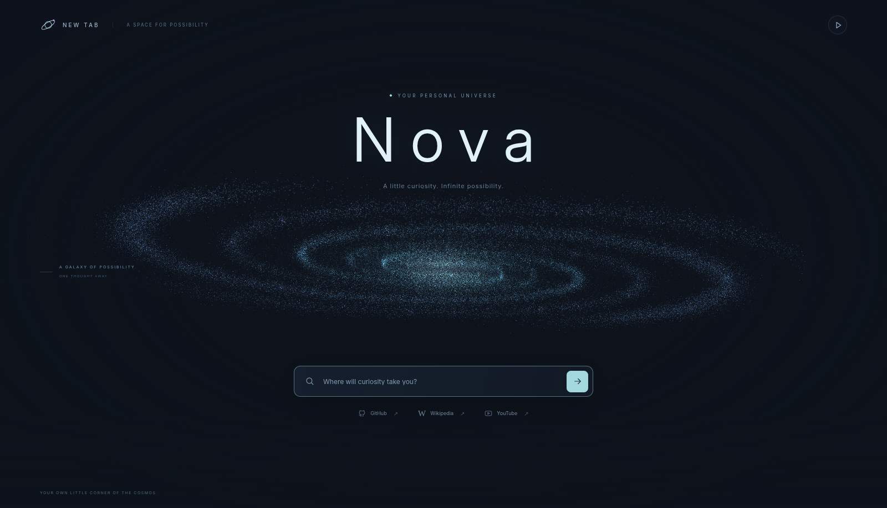
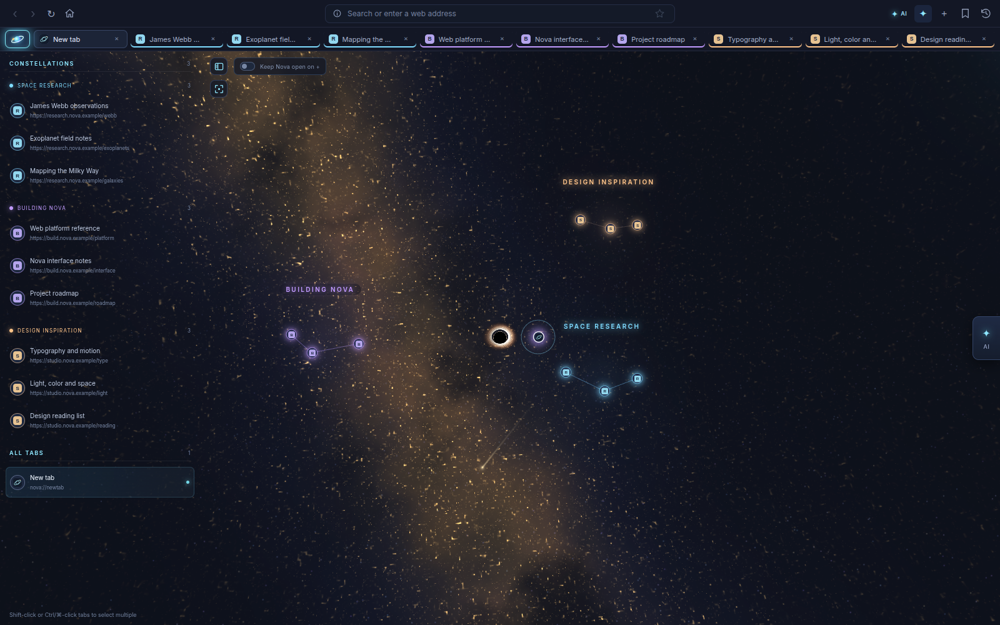
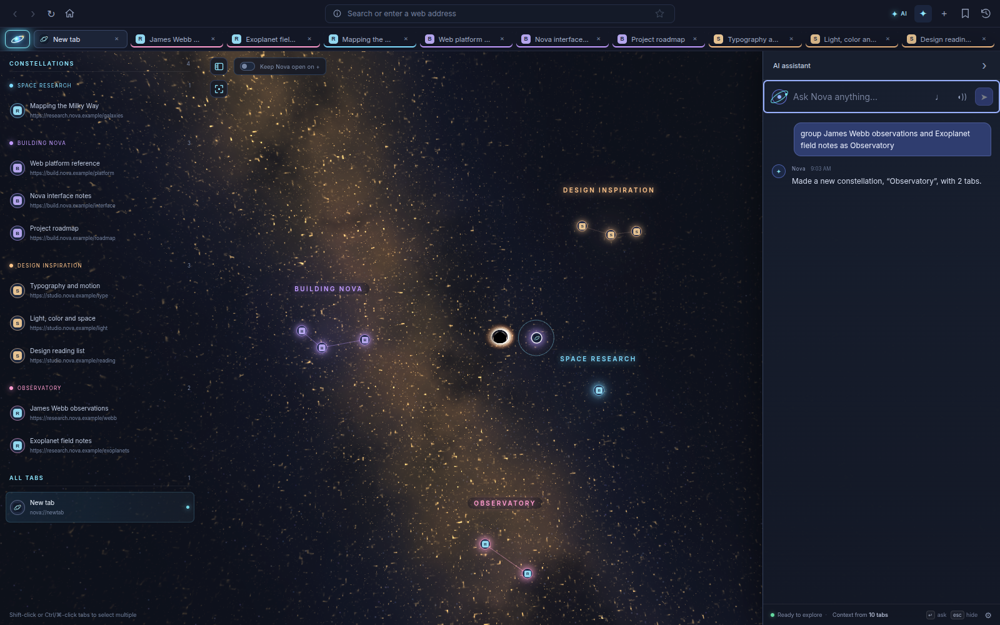
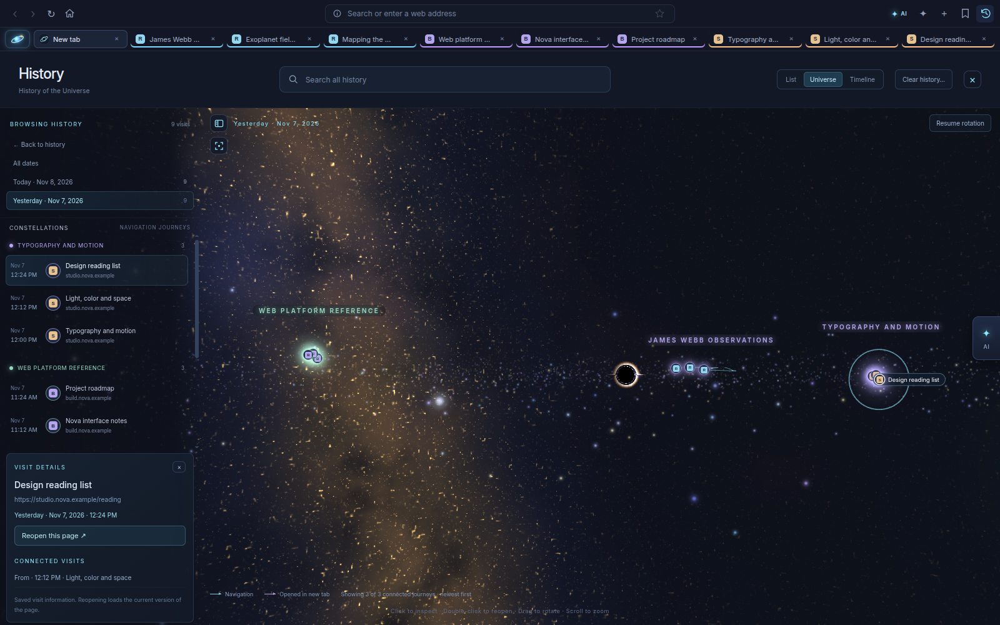
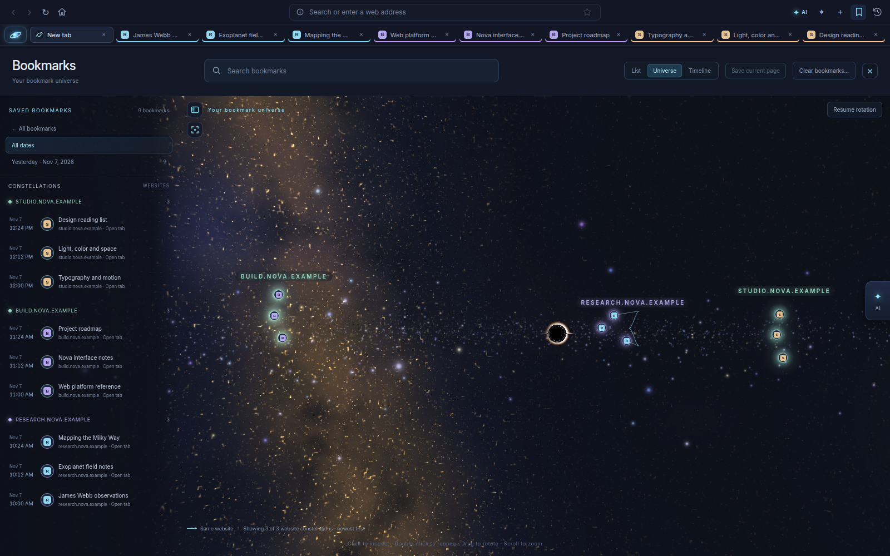
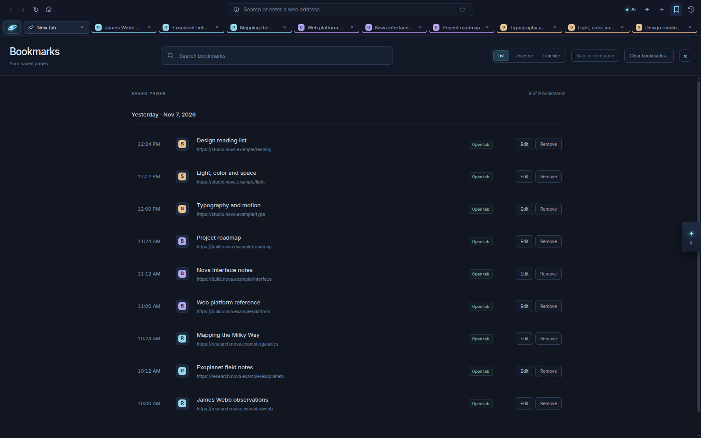
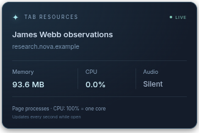

# Nova: original product captures

These are unedited captures of the running Nova application. They use an isolated temporary profile, reserved `.example` demo pages, and sample saved browsing data. No personal history, accounts, or credentials are shown.

The [main README](../../README.md) uses [presentation artwork](../images/) made from these captures. Framing, backgrounds, typography, and supporting crops belong to the presentation rather than the app interface. The exact editing prompts are recorded in [PROMPTS.md](../images/PROMPTS.md).

## New-tab experience

[](new-tab.png)

## Constellation workspace

[](constellations.png)

## Assistant organization

[](assistant.png)

## Connected history

[](history.png)

## Saved bookmarks

[](bookmarks.png)

[](bookmarks-list.png)

## Live tab resources

[](resources.png)

Resource values are a point-in-time capture, not a benchmark or a promise of typical resource consumption.

## Refresh the captures

From the project root on a machine that can run Electron:

```bash
npm run docs:capture
```

The [capture script](../../scripts/capture-readme.cjs) creates a temporary profile, loads local sample responses for `.example` pages, exercises the real app controls, saves these PNGs, and removes the temporary profile. It does not change the production browser, your profile, or website settings. Refreshing the captures does not regenerate the presentation artwork.
